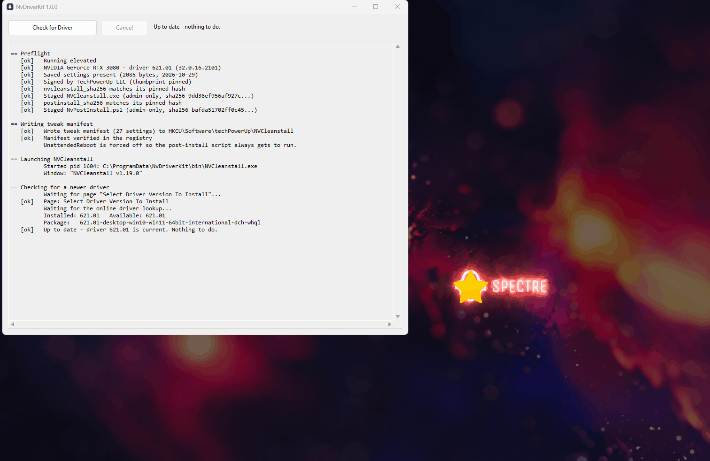

<div align="center">

# ⚡ NvDriverKit
**One-click verified NVIDIA clean installs. Reinstalls the old-school Control Panel and restores all your settings.**

[](https://github.com/elysiummachines/NvDriverKit/releases)
[](https://github.com/elysiummachines/NvDriverKit/releases)
[](https://en.cppreference.com/w/c/11)
[](https://www.microsoft.com/windows)
[](#verification)
[](LICENSE)
[](https://github.com/elysiummachines/NvDriverKit/stargazers)

[Features](#features) • [Getting Started](#getting-started) • [Security Model](#security-model) • [Technical Notes](#technical-notes)

</div>

<!-- Drop a screenshot or demo.gif here:  -->

## Overview

NvDriverKit is a plain Win32 C application that automates a full NVIDIA driver
clean install. Click one button and it checks for a newer driver, drives
[NVCleanstall](https://www.techpowerup.com/nvcleanstall/) through a verified
clean-install build, installs it, reinstalls the NVIDIA Control Panel, and puts
every one of your driver settings back.

Modern DCH driver packages no longer ship the Control Panel applet, and a clean
install erases your profiles and DSR factors. NvDriverKit handles both, so a
clean install costs you nothing.

No frameworks, no runtime dependencies, ~84 KB.

## Features

- **One button.** Version check, wizard, build, install, post-install and reboot prompt in a single run.
- **Reinstalls the Control Panel** from the Microsoft Store, which DCH driver packages leave out.
- **Restores your settings:** profiles from `MySettings.nip`, plus DSR Factors and Smoothness.
- **Shareable package.** The built installer lands on your Desktop so you can keep or pass it on.
- **Verified, not assumed.** Every checkbox is read back, every hash re-checked, the installed version re-read.
- **Signature and hash pinned.** Authenticode, signer thumbprint and SHA-256, with trust-on-first-use.
- **Silent post-install.** No console window; the script's output is relayed into the app log.
- **Hardened binary.** ASLR, high-entropy ASLR, DEP, stack protector, statically linked.

## How It Works

```
Preflight
  elevated?                                      else stop
  read installed driver from the display class key
  MySettings.nip present?                        else stop
  NVCleanstall: Authenticode + signer pin + hash pin, staged to ProgramData
  NvPostInstall.ps1: hash pin, staged to ProgramData
  clear any stale %TEMP%\NVCleanstall workspace
  write the tweak manifest to the registry, read it back

Wizard
  page "Select Driver Version To Install"
    read the available version off the best-driver label
    same as installed?   -> "Up to date", close, done
    select "Install best driver for my hardware"
    fallback servers off, background update check on
  page "Select Components To Install"
    click Minimum, verify exactly one box is ticked and it is Display Driver
  page "Installation Tweaks"
    set every checkbox by AutomationId, then read all of them back
  page "Finished"
    Build Package -> save dialog -> wait for the .exe to stop growing

Install
  package is saved to the Desktop, so it can be shared or kept
  hash it, copy to the admin-only run directory, confirm the hashes match
  run THAT copy (never the Desktop one - the Desktop is user-writable)
  delete the staged copy once the installer exits, and sweep any leftovers
  re-read the driver version; it must match what we set out to install

Post-install
  powershell -NoProfile -ExecutionPolicy Bypass -File NvPostInstall.ps1
    1. reinstall the NVIDIA Control Panel from the Microsoft Store
    2. confirm the NVIDIA Display Container service is running
    3. import MySettings.nip
    4. rewrite the DSR Factors / Smoothness bytes, per monitor
  no console window; every line it prints is relayed into the app's log
  write the GPU interrupt priority to the device key, and read it back
  offer a reboot (once, from the app)
```

Nothing is installed unless every check above passed.

## Getting Started

### Prerequisites

- Windows 10 or 11, x64, with an NVIDIA GPU
- Administrator rights
- [NVCleanstall 1.19.0](https://www.techpowerup.com/download/techpowerup-nvcleanstall/)
- `NvPostInstall.ps1`
- [WinLibs GCC](https://winlibs.com/) (UCRT) to build; no Windows SDK required

### One-Time Setup

**Do this first, while your driver settings are the way you like them.** The run
refuses to start without it, because a clean install erases everything it
restores:

```powershell
.\NvPostInstall.ps1 -Capture
```

This writes `Documents\NvPostInstall\MySettings.nip` and `DsrSettings.json`.

### Build

```bat
set PATH=C:\winlibs-extract\mingw64\bin;%PATH%
build.bat
```

MinGW-w64; needs `gcc` and `windres` on PATH. Produces `build\NvDriverKit.exe`,
statically linked with no non-system DLL dependencies.

In VS Code, <kbd>Ctrl</kbd>+<kbd>Shift</kbd>+<kbd>B</kbd> runs the same script.

Alternatively, from an *x64 Native Tools Command Prompt*:

```bat
build-msvc.bat
```

MSVC adds Control Flow Guard, CET shadow stack and `/analyze`, which MinGW
cannot provide. The source is identical.

To redraw the icon (nine sizes, 16 to 256):

```bat
powershell -ExecutionPolicy Bypass -File res\make-icon.ps1
```

### Usage

Run `build\NvDriverKit.exe` as administrator. The manifest asks for it.

| Flag | Effect |
|---|---|
| *(none)* | Full run |
| `--force` | Proceed even when the installed driver is already current (clean reinstall of the same version) |
| `--dry-run` | Drives the wizard and verifies everything, stops at the Finished page without building |
| `--probe` | Launches NVCleanstall and dumps the UIA control tree |
| `--probe-attach` | Dumps an NVCleanstall window that is already open |
| `--probe-back N` | Dumps the current page, then clicks Back and dumps again, N times |

Any page step that fails also dumps the live control tree before stopping, so a
broken run leaves behind exactly what is needed to re-map it.

> [!WARNING]
> **Do not start NVCleanstall while another copy is running.** Both instances
> share `%TEMP%\NVCleanstall`, and the second one starting will destroy the
> first one's workspace.

A complete run takes roughly 7 minutes: ~40 s through the wizard, ~2 min to
download and build the package, ~3 min to install, ~20 s for the post-install
script.

## Configuration

`%ProgramData%\NvDriverKit\config.ini`, written with defaults on first run:

```ini
[paths]
NVCleanstall=F:\Windows\Downloads\NVCleanstall_1.19.0.exe
PostInstallScript=F:\Windows\Downloads\NvPostInstall.ps1

[pins]
nvcleanstall_sha256=...
postinstall_sha256=...
```

## Security Model

- **Elevated, `uiAccess=false`.** We never drive a higher-integrity UI.
- **Signer pin.** NVCleanstall must chain-validate *and* its signer thumbprint
  must equal `67E2A570…42D307B7` (TechPowerUp LLC).
- **Hash pin, trust-on-first-use.** Both inputs are SHA-256'd and recorded in
  `config.ini` on first run. A later mismatch aborts and prints both hashes.
  Clear the `[pins]` entry to accept a deliberate update.
- **No execution from user-writable paths.** Both inputs normally live in
  Downloads, which standard users can write, and an elevated process must
  never execute from there. They are copied into `%ProgramData%\NvDriverKit\bin`,
  whose DACL is reset to SYSTEM + Administrators full control, Users
  read/execute. The DACL of anything we are about to run is walked first
  (including its parent directory) and the run is refused if any other
  principal holds write, delete or WRITE_DAC.
- **Process creation.** `CreateProcessW` with `lpApplicationName` set to an
  absolute, already-verified path. No `system()`, no `ShellExecute`, no PATH
  resolution, so there is no unquoted-path or search-order hijack to exploit.
- **Verify, don't assume.** Every checkbox is read back after being set. The
  installed version is re-read after the install, and the post-install script
  does not run if it doesn't match.
- **Audit log.** Append-only, UTF-16, in `%ProgramData%\NvDriverKit`, with the
  SHA-256 of everything executed.

## Project Structure

```
NvDriverKit/
├── src/
│   ├── common.h          # Interfaces, pins, AutomationIds
│   ├── main.c            # Win32 GUI, worker thread, reboot prompt
│   ├── wizard.c          # Orchestration: wizard, build, install, post-install
│   ├── uia.c             # UI Automation helpers
│   ├── nv.c              # Driver version parsing, tweak manifest, device key
│   ├── sec.c             # Authenticode, hashes, DACLs, staging
│   └── log.c             # Append-only audit log
├── res/
│   ├── app.ico           # Nine sizes, 16 to 256
│   ├── app.manifest      # requireAdministrator, uiAccess=false
│   ├── app.rc            # Icon + VERSIONINFO
│   ├── manifest.rc       # Compiled to default-manifest.o, shadows MinGW's
│   └── make-icon.ps1     # Regenerates app.ico reproducibly
├── build.bat             # MinGW-w64
└── build-msvc.bat        # MSVC: adds CFG, CET, /analyze
```

## Why Not Just Run NVCleanstall By Hand

**1. Auto-reboot would skip the post-install script.** The captured config had
`UnattendedReboot: true`. If the NVIDIA installer reboots on its own,
`NvPostInstall.ps1` never runs, the `.nip` never imports and the DSR bytes never
get written. `src/nv.c` forces that field off and this program owns the reboot
decision instead.

**2. The `.nip` precondition is checked before the wipe, not after.** A clean
install erases your driver settings; the script restores them from
`Documents\NvPostInstall\MySettings.nip`. If that file is missing, the run stops
before anything is touched and tells you to run `-Capture` first.

**3. Stale workspace.** NVCleanstall reuses `%TEMP%\NVCleanstall`. A leftover
tree from an earlier session can be picked up mid-build, so it is deleted
first, under a guard that only ever removes a directory of that exact name
directly under `%TEMP%`.

**4. NVCleanstall self-updates.** It checks for new versions on its own, and a
silent bump breaks every automation path. The exe is pinned by signer thumbprint
*and* SHA-256; an unexpected build stops the run instead of being clicked blind.

## Verification

| Checked | Result |
|---|---|
| Compiles, zero warnings at `-Wall -Wextra -Wshadow` | yes |
| Standalone binary | 84,480 bytes, 20 system DLLs, no others |
| ASLR / high-entropy ASLR / DEP | on (`DllCharacteristics 0x0160`) |
| Control Flow Guard | off (MinGW cannot emit it; use `build-msvc.bat`) |
| Embedded manifest | exactly one, `requireAdministrator`, no `asInvoker` |
| Version math + live registry read | 14/14 assertions, reads 621.01 correctly |
| Signature pin, hash pin, staging, DACL refusal | exercised on a live run |
| "Up to date" short-circuit | correct: 621.01 installed vs 621.01 available |
| All four wizard pages driven and verified | yes, via `--dry-run --force` |
| Build → Desktop → install → script → reboot | completed end to end |
| `nv_set_interrupt_priority` | writes and reads back on the real device |
| Silent script relay + stdin to `Read-Host` | verified against a stand-in script |
| Full run with the silent relay and registry write | completed; no console window, script exit 0, `DevicePriority = 3` |

## Technical Notes

<details>
<summary><b>What the UIA probe established</b></summary>

<br>

NVCleanstall 1.19.0 is a **WPF** app and gives every control a stable
`AutomationId`, so the automation matches on ids rather than labels wherever an
id is known. Three things the screenshots got wrong:

- `BestDriver` is **empty** when the page first appears, because the version
  lookup is still running and the combo reads `Loading...`. Searching its text for
  `-desktop-win` found nothing. The code now polls `BestDriver` for a non-empty
  name, up to 90 s.
- The two page-1 checkbox labels are longer than they look. The real names are
  `"Use fallback servers (slower, bypass Cloudflare content delivery network in
  problem areas)"` and `"Periodically check for driver updates in background
  (without contacting NVIDIA servers)"`. Exact-name matching failed on both;
  they are matched by id now.
- NVCleanstall shows its own update nag (`UpdateAvailableLink`) right on page 1,
  which is why the exe is hash-pinned.

**NVCleanstall does not apply `PreviousTweaks` to the UI.** A `--dry-run` proved
it: every checkbox on the Tweaks page came up *off*, and `UnattendedReboot` came
up *on*. Those are its defaults, not the saved settings. The "Use Previous Settings"
button exists (`UsePrevious`) but would not activate through either Invoke or
the accessibility default action. So writing the registry alone configures
nothing; each control has to be driven directly. The registry write is kept
because NVCleanstall persists it for the next manual run, but it is no longer
the mechanism.

Every checkbox on the Tweaks page has an **AutomationId identical to its key in
`PreviousTweaks`**, which is what makes driving it directly clean.

Component rows are `ListItem` elements wrapping an **unnamed** `CheckBox`. The
label lives on the row, and reads `"Display Driver"`, not `"Display Driver
(required)"` as the UI shows it.

Mapped and confirmed:

| Page | Ids |
|---|---|
| Select Driver Version | `RadioAutodetect`, `BestDriver`, `CurrentDriverVersion`, `DeviceName`, `UseFallbackServers`, `CheckInBackground` |
| Select Components | `ButtonAll`, `ButtonRecommended`, `ButtonMinimum`; rows are ListItems |
| Installation Tweaks | one id per manifest key, plus combos `MSIPolicy`, `MSIPriority`, `NvEncPatchVersions`, and `UsePrevious` |
| Finished | `BuildSFX` ("Build Package"), `RunInstaller`, `ShowInFolder`, `CopyFolder` |
| Every page | `ButtonNext`, `ButtonPrev` |

The driver itself is downloaded during **Build Package**, not earlier: the
component list comes from cached metadata, so `--dry-run` reaches the Finished
page in well under a minute and never pulls the ~800 MB payload. That makes
`--dry-run --force` a cheap way to re-verify the whole wizard path.

</details>

<details>
<summary><b>Why the interrupt priority is set through the registry</b></summary>

<br>

**The Interrupt Policy/Priority combos cannot be automated at all.** Dumping one
reads:

```
MSIPriority: type=50003 enabled=yes patterns=none 0 descendant(s)
```

A ComboBox by control type that exposes *no* UI Automation patterns and has no
children. ValuePattern, SelectionPattern, ExpandCollapse and LegacyIAccessible
all come back empty, and focus-plus-type-ahead cannot be confirmed because there
is nothing to read back. Three attempts failed before the dump made it obvious.

So the UI is left alone and the priority is written straight to the GPU's device
key after the install instead:

```
HKLM\SYSTEM\CurrentControlSet\Enum\PCI\VEN_10DE&DEV_*\<instance>
    \Device Parameters\Interrupt Management\Affinity Policy\DevicePriority
```

The device is found by walking `Enum\PCI` for the instance whose `Service` is
`nvlddmkm`, the value from the manifest is written, and it is read back to
confirm. `0` Undefined, `1` Low, `2` Normal, `3` High. The driver only reads it
at device start, which the reboot covers.

</details>

<details>
<summary><b>The tweak manifest</b></summary>

<br>

`g_manifest` in `src/nv.c` is the single source of truth for the Installation
Tweaks page. It is written to
`HKCU\Software\techPowerUp\NVCleanstall\PreviousTweaks` as JSON, then verified
twice: once by reading the registry back, once by reading the UI.

`DisableNvContainer` must stay `false`: `NvPostInstall.ps1` requires the
`NVDisplay.ContainerLocalSystem` service, and the NVIDIA Control Panel will not
open without it.

</details>

<details>
<summary><b>When NVCleanstall updates</b></summary>

<br>

The hash pin will stop the run. Then:

1. `NvDriverKit.exe --probe` and read the dump in the log.
2. Update `NVCS_WINDOW_TITLE` and any changed control names in `src/common.h`
   and `src/nv.c`.
3. Clear the `[pins]` entry for `nvcleanstall_sha256`.
4. `--dry-run` to confirm every page and checkbox still resolves.

</details>

## Known Limits

- The automation is validated against **NVCleanstall 1.19.0** only.
- Combo boxes (Interrupt Policy/Priority, NVENC patch target) are logged but not
  hard-verified in the UI; their values are enforced through the registry
  manifest instead.
- Secure Boot is fine. The re-signed package installs via NVCleanstall's own
  root certificate. **Do not enable Memory Integrity (HVCI)**; a patched,
  re-signed driver package will not load with it on.

## License

MIT. See [LICENSE](LICENSE).
